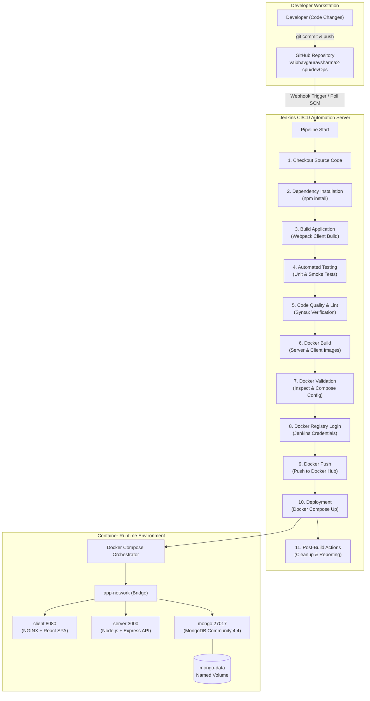

# 🎓 MERN Ecommerce - College DevOps Project Evaluation Guide

---

## 1. System Architecture & CI/CD Pipeline Workflow



---

## 2. Purpose of Docker & Jenkins in this Project

### Why Docker?
1. **Environment Parity**: Solves the classic *"it works on my machine"* problem by packaging the code, runtime, system libraries, and settings into immutable containers that run identically on developer laptops, Jenkins agents, and cloud servers.
2. **Multi-Stage Optimization**: The frontend utilizes a multi-stage Docker build. Stage 1 compiles React code with Node.js; Stage 2 serves the compiled HTML/JS/CSS using a lightweight Alpine NGINX web server (~25MB), drastically reducing attack surface and image size.
3. **Microservice Isolation**: MongoDB, Node.js backend, and NGINX frontend run in isolated container namespaces while securely communicating across an internal Docker bridge network (`app-network`).
4. **Data Persistence**: MongoDB database files reside in a dedicated Docker named volume (`mongo-data`), guaranteeing data survives container restarts or updates.

### Why Jenkins?
1. **Continuous Integration (CI)**: Automatically triggers upon every Git push, verifies dependencies, compiles assets, and runs the automated test suite. If any test fails, the build halts immediately, preventing defective code from reaching production.
2. **Quality Gate**: Validates code syntax and configuration files prior to packaging.
3. **Automated Container Lifecycle**: Automates Docker image creation, tagging with build numbers and Git commit hashes, and publishing to Docker Hub.
4. **Continuous Delivery/Deployment (CD)**: Automatically deploys the validated containers to the target environment using Docker Compose with zero manual intervention.

---

## 3. Deep Dive: Configuration Files Explained

### A. Frontend Dockerfile (`client/Dockerfile`)
```dockerfile
# Multi-stage build
FROM node:18-bullseye-slim AS builder     # Stage 1: Build environment
WORKDIR /usr/src/app
ENV NODE_OPTIONS=--openssl-legacy-provider # Webpack 4 crypto compatibility
ARG API_URL=http://localhost:3000/api
COPY package*.json ./
RUN npm install --legacy-peer-deps         # Cached layer: only runs if dependencies change
COPY . .
RUN npm run build                          # Produces production bundle in /dist

FROM nginx:1.25-alpine                     # Stage 2: Ultra-lightweight production server
WORKDIR /usr/share/nginx/html
RUN rm -rf ./*
COPY --from=builder /usr/src/app/dist .    # Copy compiled assets only; zero Node overhead
COPY nginx.conf /etc/nginx/nginx.conf      # SPA routing fallback (try_files)
EXPOSE 8080
HEALTHCHECK --interval=30s --timeout=5s CMD wget -qO- http://localhost:8080/ || exit 1
CMD ["nginx", "-g", "daemon off;"]
```

### B. Backend Dockerfile (`server/Dockerfile`)
```dockerfile
FROM node:18-bullseye-slim
WORKDIR /usr/src/app
ENV NODE_ENV=production PORT=3000
COPY package*.json ./
RUN npm install --legacy-peer-deps --production # Production-only dependencies
COPY . .
RUN chown -R node:node /usr/src/app             # Non-root permission hardening
USER node                                      # Runs process as non-root user 'node'
EXPOSE 3000
HEALTHCHECK --interval=30s --timeout=5s \
  CMD node -e "require('http').get('http://localhost:3000/api', (r) => process.exit(r.statusCode ? 0 : 1))"
CMD ["npm", "start"]
```

### C. Docker Compose (`docker-compose.yml`)
- **Service Dependencies (`depends_on`)**: The backend server waits for MongoDB's healthcheck (`condition: service_healthy`) before booting, preventing crash loops.
- **Dynamic Image Tagging**: Supports `${DOCKER_REGISTRY}` and `${IMAGE_TAG}`, allowing Jenkins to deploy specific versioned images.
- **Persistent Storage**: Maps `mongo-data` volume to `/data/db`.

### D. Jenkins Declarative Pipeline (`Jenkinsfile`)
- **11 Modular Stages**:
  1. `Checkout`: Pulls the branch matching the trigger from GitHub.
  2. `Dependency Installation`: Installs npm packages across root, client, and server.
  3. `Build`: Compiles React Webpack assets.
  4. `Test`: Executes `node --test` suite; fails pipeline if assertions fail.
  5. `Code Quality`: Validates syntax with `node -c`.
  6. `Docker Build`: Builds images tagged with `${BUILD_NUMBER}-${GIT_COMMIT}` and `latest`.
  7. `Docker Validation`: Inspects image metadata and validates Compose syntax.
  8. `Docker Registry Login`: Authenticates using Jenkins credentials (`docker login`).
  9. `Docker Push`: Pushes versioned and `latest` tags to Docker Hub.
  10. `Deployment`: Executes `docker compose up -d` to refresh running containers.
  11. `Post-Build Actions`: Cleans workspace (`cleanWs()`) and outputs deployment summary.

---

## 4. Continuous Integration vs. Continuous Deployment

| Concept | Definition | Scope in This Project |
| :--- | :--- | :--- |
| **Continuous Integration (CI)** | Automatically building, testing, and validating code whenever a developer pushes to version control. | Stages 1 through 5: Checkout, npm install, Webpack build, Unit tests, and Code quality checks. |
| **Continuous Delivery (CD)** | Automatically building release artifacts (Docker images) and staging them in an artifact registry ready for release. | Stages 6 through 9: Docker build, Docker validation, Docker Hub login, and pushing images. |
| **Continuous Deployment (CD)** | Automatically releasing the validated build straight into production without manual approval gates. | Stage 10: Docker Compose deployment updating live containers. |

---

## 5. Live Demonstration Guide for Evaluator

Follow these exact steps when demonstrating the project to your college professor/evaluator:

### Step 1: Show Codebase & Git Status
1. Open terminal in `D:\MERNSTACK`.
2. Run `git status` and `git log --oneline -5` to show clean git commits.
3. Show remote connection: `git remote -v` pointing to `https://github.com/vaibhavgauravsharma2-cpu/devOps.git`.

### Step 2: Demonstrate Automated Tests Passing
1. Run `npm test` in terminal.
2. Show the evaluator that both Server (5 tests) and Client (4 tests) pass with green TAP output in < 3 seconds.
3. Run `npm run lint` to prove syntax validation passes.

### Step 3: Show Docker Architecture
1. Open `docker-compose.yml`, `client/Dockerfile`, and `server/Dockerfile`.
2. Highlight:
   - Multi-stage build in frontend (Node.js -> NGINX).
   - Non-root user security in backend (`USER node`).
   - Container healthchecks and bridge networking.

### Step 4: Show Jenkins Pipeline Execution
1. Open Jenkins dashboard at `http://localhost:8080` (or your configured Jenkins URL).
2. Click on the Pipeline job **`mern-ecommerce-pipeline`**.
3. Click **Build with Parameters** -> Click **Build**.
4. Show the **Stage View** progressing through all 11 stages with green status boxes.
5. Click on the latest build -> **Console Output** -> show Docker build logs, test logs, and the final green success message.

### Step 5: Show Live Running Store
1. Open browser at `http://localhost:8080`.
2. Demonstrate store homepage loading products from MongoDB.
3. Log in with admin credentials (`admin@example.com` / `Admin@123`).
4. Show Admin dashboard.

---

## 6. Common Errors & How to Troubleshoot

| Error Symptom | Root Cause | Solution / Fix |
| :--- | :--- | :--- |
| `Cannot connect to the Docker daemon at unix:///var/run/docker.sock` | Docker service/Docker Desktop is stopped or not running. | Start Docker Desktop on Windows. In Linux, run `sudo systemctl start docker`. |
| `ERR_OSSL_EVP_UNSUPPORTED` during Webpack build | Node 17+ uses OpenSSL 3.0 which disables legacy MD4 hashes used by older Webpack 4. | Set environment variable `NODE_OPTIONS=--openssl-legacy-provider`. |
| React app 404 on page refresh in Docker | NGINX tries to find a physical HTML file for client-side React routes. | In `nginx.conf`, configure `try_files $uri /index.html;` so all routes fallback to React SPA. |
| `docker login` fails in Jenkins | Incorrect credentials ID or missing Docker Hub Access Token. | In Jenkins -> Manage Jenkins -> Credentials, add `dockerhub-credentials` with Docker Hub token. |
| `ECONNREFUSED mongo:27017` on server startup | Server container started before MongoDB was ready to accept connections. | Use Docker Compose `depends_on` with `condition: service_healthy` and MongoDB `healthcheck`. |
| Disk space full during Jenkins builds | Dangling Docker build caches and unused images accumulating over time. | Run `docker system prune -af --volumes` or configure `cleanWs()` in Jenkinsfile. |

---

## 7. Top 17 Viva Questions & Detailed Answers

### Q1: What is the fundamental difference between a Docker Image and a Container?
> **Answer:** A Docker Image is an immutable, read-only template or blueprint containing application code, runtime, system tools, and dependencies. A Container is a runnable, isolated runtime instance of that image with a thin read-write layer added on top.

### Q2: Why did you use a Multi-Stage Dockerfile for the frontend client?
> **Answer:** In a standard single-stage build, the final image retains the Node.js runtime, npm cache, source files, and developer dependencies, resulting in an image exceeding 1 GB. In our multi-stage build, Stage 1 uses Node.js to compile the React bundle into static HTML/CSS/JS, and Stage 2 copies only those compiled files into an ultra-lean Alpine NGINX image (~25 MB). This drastically reduces image size, speeds up download times, and eliminates security vulnerabilities.

### Q3: What is the purpose of the `.dockerignore` file?
> **Answer:** `.dockerignore` prevents unnecessary files (such as host `node_modules`, `.git`, environment files, and build logs) from being copied into the Docker build context. This speeds up build times, keeps images lean, and avoids architecture incompatibility between host and container binaries.

### Q4: Explain the difference between Declarative and Scripted Jenkins Pipelines. Which one did you choose and why?
> **Answer:** Declarative Pipeline uses a strict, structured, and opinionated syntax (`pipeline { stage { steps } }`) that is easier to read, validates syntax upfront, and includes built-in post-actions. Scripted Pipeline uses a Groovy DSL with fewer structural constraints. We chose Declarative Pipeline because it is industry standard, provides robust stage visualization, and handles error handling cleanly.

### Q5: Why is running containers as the `root` user considered dangerous? How did you address this?
> **Answer:** Running as root inside a container means that if an attacker exploits a remote code execution vulnerability, they have root privileges inside the container namespace and can potentially escape to the host kernel. We mitigated this in `server/Dockerfile` by using the built-in non-privileged `node` user (`USER node`).

### Q6: How do containers communicate with each other in Docker Compose?
> **Answer:** Docker Compose creates a default user-defined bridge network (`app-network`). Docker includes an embedded DNS server that resolves container names and service names to their dynamic IP addresses. For example, our server connects to `mongodb://mongo:27017` using the service name `mongo`.

### Q7: What is Docker Hub's role in this CI/CD pipeline?
> **Answer:** Docker Hub acts as a centralized container registry. Once Jenkins builds and tests the images, it publishes them to Docker Hub tagged with the unique build number and Git commit hash. Any deployment environment (staging, production, Kubernetes) can then pull the exact immutable artifact.

### Q8: How are secrets and passwords securely handled in Jenkins?
> **Answer:** We never hardcode secrets in the `Jenkinsfile` or commit them to Git. We use Jenkins Credentials Store to store the Docker Hub password / access token under the ID `dockerhub-credentials`. The pipeline accesses them dynamically in memory using `withCredentials([usernamePassword(...)])`, which automatically masks passwords from console logs.

### Q9: What happens if a unit test fails during the `Test` stage in Jenkins?
> **Answer:** The `npm test` process exits with a non-zero exit code (`exit code 1`). Jenkins detects this failure, immediately terminates pipeline execution, marks the build as `FAILED`, and triggers the `post { failure { ... } }` block. No Docker image is built or deployed, ensuring broken code never reaches production.

### Q10: What is the difference between `COPY` and `ADD` in a Dockerfile?
> **Answer:** `COPY` copies local files/directories from the build context into the container. `ADD` has additional capabilities: it can download files from remote URLs and automatically extract tar archives. Best practice is to use `COPY` for predictability unless archive extraction is explicitly required.

### Q11: How is data persisted in MongoDB when running in a Docker container?
> **Answer:** Containers are ephemeral by default. To preserve database data across container restarts or deletions, we use a Docker named volume (`mongo-data`) mounted to MongoDB's internal data directory `/data/db`. Docker manages this storage on the host filesystem independently of the container lifecycle.

### Q12: Why did you add a `healthcheck` to MongoDB in `docker-compose.yml`?
> **Answer:** When `docker compose up` starts containers, `depends_on` only waits until the dependent container has started, not until its internal database engine is ready to accept socket connections. By adding a MongoDB healthcheck (`db.runCommand("ping")`) and specifying `condition: service_healthy` on the server, the backend waits until MongoDB is fully operational.

### Q13: What is the difference between Blue-Green Deployment and Rolling Deployment?
> **Answer:** In Blue-Green deployment, two identical environments exist (Blue = live, Green = idle). The new release is deployed to Green; once verified, router traffic is switched to Green. In Rolling deployment, instances are upgraded one by one behind a load balancer with zero downtime.

### Q14: How does Jenkins receive automatic triggers when code is pushed to GitHub?
> **Answer:** Through GitHub Webhooks. When a developer pushes code, GitHub sends an HTTP POST payload to Jenkins at `http://<jenkins-url>/github-webhook/`. Jenkins inspects the payload, identifies the matching pipeline job, and triggers the build automatically.

### Q15: Why did you use NGINX instead of a simple Node server for the frontend in production?
> **Answer:** NGINX is an event-driven, asynchronous C-based web server engineered specifically for high-concurrency static asset delivery, caching, compression, and reverse proxying. It consumes significantly less CPU and memory (~15MB RAM vs ~100MB+ for Node.js) and includes robust HTTP security headers.

### Q16: How do you roll back to a previous version if a deployment has a critical bug?
> **Answer:** Because every Docker image is tagged with its unique build number (e.g. `vaibhavsharma/mern-server:42-a1b2c3d`), rolling back is as simple as running:
```bash
IMAGE_TAG=42-a1b2c3d docker compose up -d
```
Docker immediately pulls and starts the previous working images.

### Q17: What are Docker layer caches and how did you optimize them in your Dockerfiles?
> **Answer:** Docker builds images in sequential layers. If a layer and its preceding layers haven't changed, Docker reuses the cached layer. In both Dockerfiles, we copied `package*.json` and ran `npm install` *before* copying the application source code (`COPY . .`). Because dependencies change far less often than code, Docker skips downloading npm packages on subsequent builds, reducing build times from minutes to seconds.
